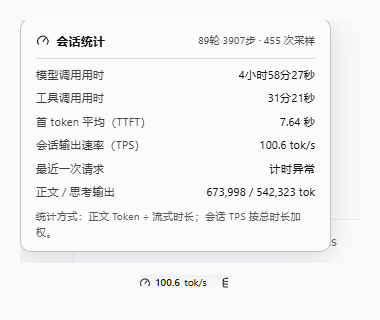
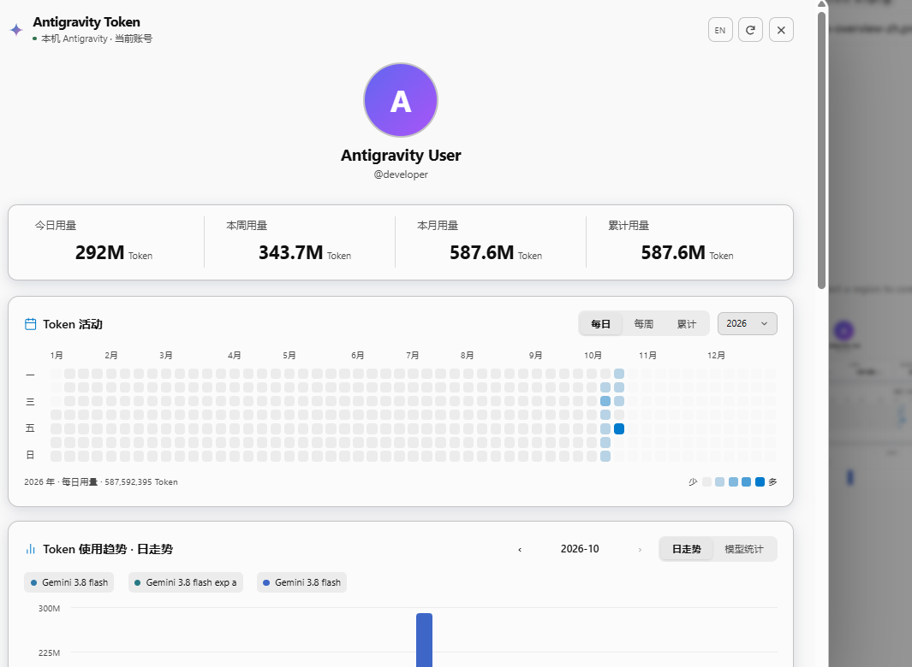

<div align="center">


# Antigravity PowerToys

### All-in-One Workspace Powerpack for Google Antigravity: Fisheye Conversation Timeline, Local File Context Menu, Real-Time Token Analytics HUD, and Modern Chat UI Enhancements

An all-in-one productivity powerpack seamlessly integrating usage analytics, conversation timeline scrubbing, local file navigation, and UI aesthetics for Google Antigravity. Glide through long conversation turns with the mountain-peak fisheye minimap; reveal and open local file links directly in your operating system's native tools; monitor token throughput and quota reset countdowns inline; or dive into a dedicated Codex-style Token Analytics Dashboard.<br>
Unobtrusive by default. Rich, actionable workspace power at your fingertips.

[](CHANGELOG.md)
[](https://github.com/YOU-SHOULD-KNOW-ME/antigrative-dashboard)
[](COMPATIBILITY.md)
[](LICENSE)

[Preview](#preview) · [Acknowledgements & Credits](#acknowledgements--credits) · [Key Highlights](#key-highlights) · [IDE](#antigravity-ide) · [CLI Status Line](#antigravity-cli-status-line) · [Installation](#installation) · [FAQ](#faq) · [中文文档](README.zh-CN.md)

</div>

---

> [!IMPORTANT]
> ### Acknowledgements & Credits
> 
> This project (**Antigravity Token Plugin**) is an enhanced fork and redesign based on the open-source project **[antigrative-dashboard](https://github.com/YOU-SHOULD-KNOW-ME/antigrative-dashboard)** created by **[YOU-SHOULD-KNOW-ME](https://github.com/YOU-SHOULD-KNOW-ME)**.
> 
> We extend our deepest gratitude to the original author for pioneering the sidecar CDP debugging injection, local history collection, and cross-platform architecture! Building on that strong foundation, this project introduces enlarged typography, streamlined inline progress bars, a redesigned card layout, and a full HUD-grade Token Analytics Dashboard featuring dual contribution grids (daily & weekly), cumulative total area charts with data points, multi-model fixed comparison bar charts, a 10-day paginated daily audit table, and integrated one-click repository self-updates.
> 
> * Original Author: [@YOU-SHOULD-KNOW-ME](https://github.com/YOU-SHOULD-KNOW-ME)
> * Original Repository: [antigrative-dashboard](https://github.com/YOU-SHOULD-KNOW-ME/antigrative-dashboard)

---

## Preview

<table>
<tr><th width="50%">Generation Speed Details</th><th width="50%">Streamlined Context & Quotas Card</th></tr>
<tr>
<td width="50%" valign="top"></td>
<td width="50%" valign="top"></td>
</tr>
</table>

<table>
<tr><th width="50%">Activity Overview (Codex Bar & Heatmap)</th><th width="50%">Model Breakdown, 6-Grid & Daily Audit Table</th></tr>
<tr>
<td width="50%" valign="top"></td>
<td width="50%" valign="top"></td>
</tr>
</table>

---

## Key Highlights

### 1. Fisheye Conversation Minimap & Scrubber
- **Mountain-Peak Fisheye Expansion**: Conversation turns are mapped as discrete ticks on the left rail of the chat view. Moving near them creates a sharp, natural mountain peak expansion (base 6px to 26px peak) instead of a chaotic wave.
- **Strict Single-Line Highlight**: Only the single closest tick to your cursor changes color (crisp `#ffffff` in Dark mode, `#111111` in Light mode). All other lines maintain their original palette without color bleed.
- **Pixel-Grid Snapping**: Automatically detects `window.devicePixelRatio` and locks every tick to physical device pixel rows, completely eliminating blurry or "one thicker, one thinner" anti-aliasing artifacts on fractional DPI displays.
- **Fixed-Distance Preview Popover**: The floating preview card is rock-solid anchored at an exact 38px horizontal distance from the scrubber rail. It never jitters or jumps as ticks expand, highlighting quoted user turns and assistant summaries.
- **Milestone Turn Bookmarks**: Click the bookmark icon in any turn preview to add a clean monochrome dot `·` to the timeline rail, making long chat navigation effortless.
- **Instant Snap-Back**: Moving onto the preview card or leaving the rail instantly snaps all ticks back to the base 6px length.

### 2. Local File Context Menu
- **Break Free from the Side Pane**: Right-click any local file hyperlink generated in model responses for a native contextual popup menu.
- **Reveal in File Explorer**: Instantly open Windows Explorer (or macOS Finder / Linux file manager) with the target file highlighted.
- **Open in Default Application**: Launch the file directly in your preferred system editor (VS Code, external IDEs, image viewers, etc.).
- **Open With...**: Trigger the system application selector dialog for flexible tool switching.
- **Quick Preview**: View the first 200 lines of file contents in a smooth popover without opening external heavyweight software.

### 3. Borderless Clean Chat Bubbles
- **Modern Borderless Styling**: Clean, frameless layout adapting dynamically to Dark and Light modes.
- **High-Contrast Readability**: Deep Morandi neutral `#222222` with pure white text in dark mode, matching the composer seamlessly; soft `#F0F0F0` in light mode.
- **Clean Message Separation**: Preserves assistant markdown typography while clearly delineating user inputs.

### 4. Refined Hover Detail Popovers & Typography
- **Larger, Legible Typography**: Base font sizes upgraded to 12.5px ~ 13.5px for crisp readability without squinting.
- **Inline Progress Bars**: Context usage bars now sit directly inline with the percentage values, eliminating unnecessary extra lines.
- **Top-Right Quota Group Selector**: Switched the `Gemini ▾` / `Claude/GPT ▾` selector and refresh button into the card's header, maximizing usable space.
- **Merged Reset Countdown**: Reset times and live countdowns are combined into a clean single line: `Reset Time 10/17 01:23 (02:14:04)`.

### 5. Full-Featured Token Analytics Dashboard (HUD)
- **Profile Header**: Displays your avatar, nickname, and handle via live `GetUserStatus` RPC (with hover reveal for masked email).
- **Codex-Style Hero Metrics Bar**: Today, Weekly, Monthly, and Total cumulative usage prominently displayed with centered numbers and left-aligned labels.
- **Dual Heatmap Contribution Grids**:
  - **Annual Daily Heatmap**: 7×53 GitHub-style calendar grid with date hover popups and single-day selection.
  - **Annual Weekly Heatmap**: 2×27 half-year split grid featuring a smooth diagonal ripple reveal animation.
- **Cumulative Area Curve**: Smooth Bezier area chart with interactive data points and date axis labels.
- **Multi-Model Comparison Bar Chart**: Day, week, and month view switcher with unified Morandi color palette and fixed 3-model x-axis scaling.
- **6-Grid Metric Breakdown**: Uncached input, cache reads, cache writes, output tokens, turns, and session counts.
- **10-Day Paginated Daily Audit Table**: Detailed historical audit logs broken down by model and day, complete with expandable sub-rows and pagination.
- **One-Click Update Checker**: Directly queries this repository's releases for updates, offering one-click upgrades and hot reload.

### 6. Smart Session Awareness & Privacy
- **Subagent-Aware**: Child agents get their own independent throughput, cache rate, and context metrics in their composer.
- **Non-Intrusive Hover Transitions**: 250ms anti-jitter delay on first hover; instantaneous switching between metrics once active; closes 350ms after leaving.
- **Theme Adaptive**: Harmonizes with light/dark modes and custom accent colors automatically.
- **100% Local & Private**: Direct loopback collection and local disk storage. Never transmits your metrics or conversation contents to any third-party servers.

---

## Antigravity IDE

A standalone VSIX package is available for the Google Antigravity standalone IDE. In the Extensions view, select **Install from VSIX…** without requiring the desktop App.

Quit the IDE completely, then launch it with:
```bash
--remote-debugging-port=0 --remote-debugging-address=127.0.0.1
```
Responsive controls automatically switch to 3-icon mode on narrow panes. See [IDE instructions](ide/README.md).

---

## Antigravity CLI Status Line

An independent adapter for the official Antigravity CLI `statusLine` interface:
- Displays context occupancy, cache read tokens, status, and grouped quotas in your terminal footer.
- Visual quota bars with 3-tier colors: **Green ≥70%, Yellow ≥30%~70%, Red <30%**.
- Preview: `node cli/statusline.mjs --preview`.
- Install: `python manage.py install-cli` (Linux/macOS: `python3`). See [CLI documentation](docs/CLI.md).

---

## Installation

### Desktop App (Windows / Linux / macOS)

Supported on **Antigravity Desktop App 2.21.1 / 2.22.0+** with **Python 3.10+**.

1. **Clone this repository**:
   ```powershell
   git clone https://github.com/Hanako-777/Antigravity-Token-Plugin.git
   cd Antigravity-Token-Plugin
   ```

2. **Run the installer**:
   ```powershell
   python manage.py install
   ```
   *(Linux / macOS: `python3 manage.py install`, PowerShell: `./install.ps1`)*

3. **Restart Antigravity**:
   Fully restart your Antigravity application. Open any chat to see the live metrics strip beside the model selector!

<details>
<summary><strong>Let an AI Agent install it: View prompt</strong></summary>

```text
Please help me install and enable Antigravity Token Plugin.
Repository: https://github.com/Hanako-777/Antigravity-Token-Plugin
1. Read README.md, COMPATIBILITY.md, docs/CLI.md, and ide/README.md. First perform
   read-only checks to analyze the OS, executable paths, host version, and existing
   plugin configurations. Distinguish among Desktop App, Antigravity CLI (agy),
   and standalone Antigravity IDE.
2. Before downloading packages or modifying files, explain which hosts were detected
   and ask for confirmation on whether to install the App, CLI, or standalone IDE adapter.
3. Check the latest release, verify SHA256, and extract the source into a dedicated directory.
4. Using Python 3.10+ (python3 on Linux/macOS), run according to target:
   - Desktop App: python manage.py status, then python manage.py install.
   - CLI: verify agy --version and Node.js 20+, run python manage.py install-cli.
   - Standalone IDE: Install via VSIX or ide/manage.py install.
5. Preserve existing settings and historical data. Advise when a host restart is required.
6. Verify inside the host and summarize the installed version, target path, and management commands.
```

</details>

### Plugin Management Commands

Run from the project root:

| Action | Command | Details |
| :--- | :--- | :--- |
| **Install / Update** | `python manage.py install` | Copies runtime adapter while preserving all history and preferences |
| **Disable** | `python manage.py disable` | Temporarily hides the widget |
| **Enable** | `python manage.py enable` | Restores widget visibility |
| **Status** | `python manage.py status` | Checks attachment health and port discovery |
| **Uninstall** | `python manage.py uninstall` | Cleanly removes the plugin with backups preserved |

---

## Measurement Methodology

| Metric | Calculation |
| :--- | :--- |
| **Session Weighted TPS** | Total body output tokens ÷ total streaming duration for valid turns |
| **Last-Request TPS** | Output tokens of latest turn ÷ its streaming duration; excludes anomalies |
| **TTFT** | Time elapsed from request start until first token received |
| **Model vs Tool Time** | Distinguishes pure model streaming time from merged tool call execution intervals |
| **5h / Weekly Quotas** | Direct `remainingFraction` returned by the official account API |
| **Reset Countdown** | Dynamically calculated from official `resetTime` down to the second |

---

## FAQ

<details>
<summary><strong>Q: Widget does not appear after installation?</strong></summary>

1. Ensure the Antigravity main process was **completely terminated** before relaunching (not just closing the window).
2. Run `python manage.py status` to inspect connection health.
3. Check the sidecar log at `~/.gemini/antigravity/sidecar_data/antigravity-pulse/panel/logs/sidecar.log`.
</details>

<details>
<summary><strong>Q: Why does a new chat show no TPS initially?</strong></summary>

To prevent displaying misleading throughput from previous sessions, TPS is intentionally hidden in fresh chats until the model completes its first response.
</details>

<details>
<summary><strong>Q: Why do Gemini and Claude/GPT show different balances?</strong></summary>

The backend assigns separate quota pools and reset cadences to Gemini and Claude/GPT models. The widget follows your active model by default and allows manual switching via the top-right menu.
</details>

<details>
<summary><strong>Q: Do I need to reinstall after updating Antigravity?</strong></summary>

The plugin connects via the Electron local debugging port without patching `app.asar`. The adapter automatically reconnects after host updates. For major host updates, run `python manage.py install` to refresh adapter hooks.
</details>

---

## License & Credits

- Licensed under the [MIT License](LICENSE).
- Deepest appreciation again to the original author **[YOU-SHOULD-KNOW-ME](https://github.com/YOU-SHOULD-KNOW-ME)** for the pioneering **[antigrative-dashboard](https://github.com/YOU-SHOULD-KNOW-ME/antigrative-dashboard)** project.
- "Antigravity" is a trademark of Google LLC. This project is an independent community extension and is not affiliated with Google.
