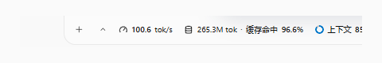
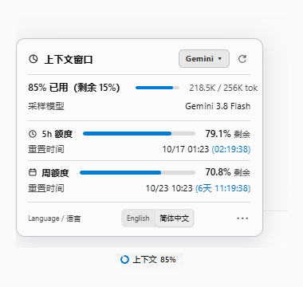
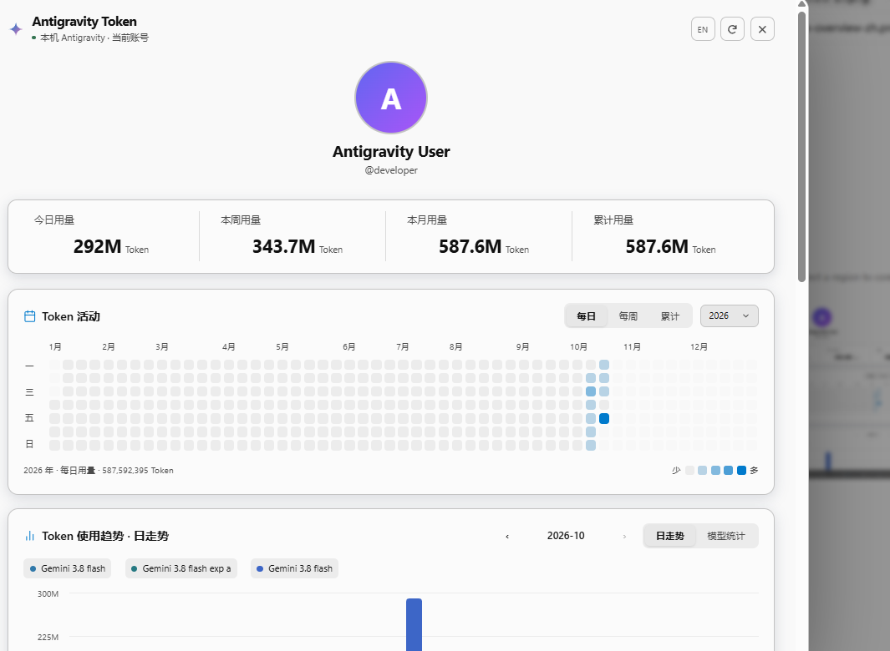
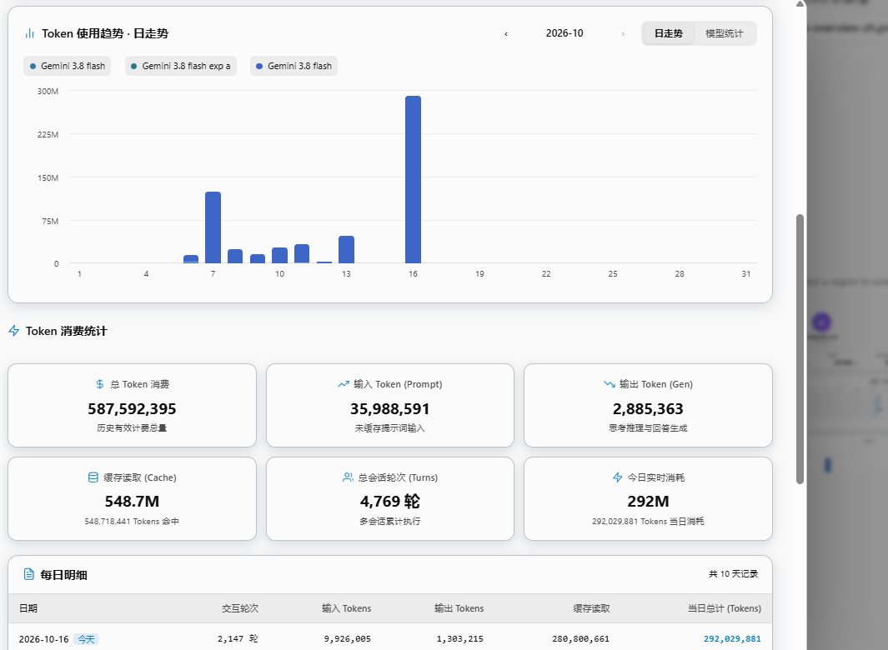

<div align="center">



# Antigravity Token Plugin

### 反重力 AI 会话速率、缓存、额度与全功能 Token 用量统计面板

模型选择旁直观显示生成速率、缓存命中率和上下文占用；悬停展开全新大字号精简详情卡；更有独立的 Codex 风格全功能 Token 用量分析中心。<br>
极简常驻，沉浸交互，全面掌控你的 AI Token 资产。

[](CHANGELOG.md)
[](https://github.com/YOU-SHOULD-KNOW-ME/antigrative-dashboard)
[](COMPATIBILITY.md)
[](LICENSE)

[功能预览](#功能预览) · [原作者与致谢](#原作者与致谢) · [核心特色](#核心特色) · [IDE 适配](#antigravity-ide) · [CLI 状态栏](#antigravity-cli-状态栏) · [安装指南](#安装指南) · [常见问题](#常见问题) · [English](README.md)

</div>

---

> [!IMPORTANT]
> ### 原作者与致谢 / Acknowledgements
> 
> 本项目（**Antigravity Token Plugin**）深度衍生并重构自原作者 **[YOU-SHOULD-KNOW-ME](https://github.com/YOU-SHOULD-KNOW-ME)** 的开源项目 **[antigrative-dashboard](https://github.com/YOU-SHOULD-KNOW-ME/antigrative-dashboard)**。
> 
> 感谢原作者在反重力插件架构、CDP 调试注入、本地会话采集与多端适配上奠定的坚实基础与卓越贡献！本项目在原版优秀架构的基础上，进行了界面的深度美化与字号重构、紧凑排版优化，并新增了全功能 HUD 级 Token 用量中心（双热力图格子、累计面积走势图、多模型固定对比柱状图、10 天分页审计表与仓库自升级机制）。
> 
> * 原作者 GitHub：[@YOU-SHOULD-KNOW-ME](https://github.com/YOU-SHOULD-KNOW-ME)
> * 原项目仓库：[antigrative-dashboard](https://github.com/YOU-SHOULD-KNOW-ME/antigrative-dashboard)

---

## 功能预览

<table>
<tr><th width="50%">生成速度详情</th><th width="50%">全新上下文与额度精简卡片</th></tr>
<tr>
<td width="50%" valign="top"></td>
<td width="50%" valign="top"></td>
</tr>
</table>

<table>
<tr><th width="50%">活动概览（Codex 数据栏与贡献热力图）</th><th width="50%">模型趋势、6宫格统计与每日审计明细</th></tr>
<tr>
<td width="50%" valign="top"></td>
<td width="50%" valign="top"></td>
</tr>
</table>

---

## 核心特色

### 1. 全新大字号与精简悬浮卡
- **清晰大字号排版**：采用 12.5px ~ 13.5px 优雅基准字号，相比原版微小字体更易看清，减少视力疲劳。
- **上下文进度条内联设计**：上下文占用进度条直接紧随百分比数值右侧同行显示，不再拆行，卡片更精致紧凑。
- **额度组切换器移至右上角**：`Gemini ▾` / `Claude/GPT ▾` 下拉组和刷新按钮移入卡片头部右上角，大幅释放纵向空间。
- **重置时间与倒计时合二为一**：合并为如 `重置时间 10/17 01:23 (02:14:04)` 格式，剔除冗余的“重置倒计时”独立行。

### 2. 全功能 Token 用量统计中心 (HUD)
- **个人档案区域**：展示用户头像、昵称、用户名，悬停可查看脱敏邮箱。
- **Codex 风格核心数据栏**：今日用量、本周用量、本月用量、历史累计总消耗四列排布，指标标签居左、数值居中大字号高对比呈现。
- **双热力图贡献网格 (Heatmap)**：
  - **年度每日贡献图**：7×53 GitHub 风格方格图，支持悬停日期提示及点击单日过滤。
  - **年度每周贡献图**：2×27 双半年紧凑网格图，配备对角线波纹丝滑加载动画。
- **累计总消耗面积走势图**：平滑贝塞尔面积曲线，附带悬浮交互数据打点 (Data Points) 与关键日期标尺。
- **多模型对比柱状图**：天 / 周 / 月多维度视图，采用统一莫兰迪色系 (Morandi)；点击单日时保持多模型横坐标稳定，柱高自适应。
- **6 宫格用量细节统计**：未缓存输入、缓存读取、缓存写入、正文输出、对话轮次等全面量化。
- **10 天分页每日明细审计表 (Audit Table)**：按天精确审计每一天的模型调用分布、输入 / 缓存 / 输出明细，支持平滑翻页与独立折叠。
- **一键检查更新**：直接连接本仓库检查发布版本，支持自动检测更新与安全热重载。

### 3. 会话与多代理感知
- **子代理独立统计**：在子代理输入框旁展示子代理专属的生成速率、缓存与上下文，详情卡清晰区分子代理与全局账户额度。
- **智能防误触悬停**：首次悬停延时 250ms 触发，卡片激活后在各指标间切换即时响应，离开 350ms 后自动关闭。
- **主题完美跟随**：自动适配 Antigravity 的深浅主题配色及自定义高亮色，保证文字高可读性。
- **安全本地留存**：仅通过本机回环接口与本地文件存储，不上传任何对话内容或用量至第三方服务器。

---

## Antigravity IDE

提供独立的 VSIX 扩展包，直接适配 Google Antigravity 独立 IDE。在 IDE 扩展视图选择「从 VSIX 安装」即可，无需安装桌面端 App。

完全退出 IDE 后，通过添加以下参数启动 IDE：
```bash
--remote-debugging-port=0 --remote-debugging-address=127.0.0.1
```
在宽窄窗口下自动自适应（窄窗口为三图标模式，拉宽后显示数值）。详见 [IDE 安装与说明文档](ide/README.md)。

---

## Antigravity CLI 状态栏

针对官方 Antigravity CLI 提供了独立轻量状态栏适配器（`statusLine`）：
- 终端底部实时显示上下文占用、缓存读取 Token、会话状态与分组额度。
- 额度进度条按剩余量三色警示：**≥70% 绿色、≥30%~70% 黄色、<30% 红色**。
- 预览命令：`node cli/statusline.mjs --preview --language zh-CN`。
- 安装命令：`python manage.py install-cli`（Linux/macOS 使用 `python3`）。详见 [CLI 文档](docs/CLI.md)。

---

## 安装指南

### 桌面端 App 安装 (Windows / Linux / macOS)

适用于 **Antigravity 桌面 App 2.21.1 / 2.22.0+**，要求系统已安装 **Python 3.10+**。

1. **克隆本仓库并进入目录**：
   ```powershell
   git clone https://github.com/Hanako-777/Antigravity-Token-Plugin.git
   cd Antigravity-Token-Plugin
   ```

2. **执行一键安装**：
   ```powershell
   python manage.py install
   ```
   *(Linux / macOS 用户请使用 `python3 manage.py install`，PowerShell 用户也可直接运行 `./install.ps1`)*

3. **重启 Antigravity**：
   完全退出并重新打开 Antigravity 桌面应用，进入任意对话，输入框上方或模型选择器旁即可看到控件！

<details>
<summary><strong>让 Agent 帮你安装：展开完整提示词</strong></summary>

```text
请帮我安装并启用 Antigravity Token Plugin。
仓库：https://github.com/Hanako-777/Antigravity-Token-Plugin
1. 读取 README.md、COMPATIBILITY.md、docs/CLI.md 和 ide/README.md。先用只读检查
   分析系统、可执行文件、宿主版本和已有插件配置，区分桌面 App、Antigravity CLI
   （agy）和独立 Antigravity IDE；不能仅凭系统判断安装目标。
2. 下载安装包或修改配置前，向我说明检测到哪些宿主，并让我明确确认要安装
   App、CLI 还是独立 IDE 适配。如同时安装了多个，让我选一个或多个；无法识别
   则询问可执行文件路径。不要因为我是 Linux 或在终端里就默认安装桌面端。
3. 查询最新稳定发布，说明插件版本、宿主版本和路径、选定适配器。App 与 CLI
   共用 ZIP，但安装命令不同；独立 IDE 使用单独 VSIX。只下载已确认目标需要的
   文件并校验 SHA256，将源码解压到固定目录。不要未经单独确认安装、升级、
   降级或替换 Antigravity 宿主。
4. 使用 Python 3.10+（Linux/macOS 通常用 python3），按确认的目标执行：
   - App：先 python manage.py status，再 python manage.py install。
   - CLI：检查 agy --version 和 Node.js 20+，执行 python manage.py install-cli，
     不要执行 manage.py install。已有 statusLine 按 CLI 文档备份／覆盖流程处理。
     CLI 缓存率有适用条件，按 docs/CLI.md 核对实测模型／版本及不可用情况。
     不承诺 CLI 展示 tok/s 或本地用量图表，这些不在 CLI 适配范围内。
   - 独立 IDE：通过 Install from VSIX... 安装发布版 VSIX，或使用
     ide/manage.py install --exe <已核实的IDE可执行文件> --vsix <发布版VSIX>。
     不需要桌面 App，不要执行 App 安装器。
5. 保留其他设置和已保存数据。需要重启或登录时先告知，不强制结束正在执行的
   任务。IDE 按文档保留本机回环调试启动参数；CLI 在新会话中验证。
6. 在选定的真实宿主中验证，报告插件／宿主版本、安装目标和路径、实际完成的
   检查、剩余步骤，以及该适配器的停用／卸载方法。下载 ZIP 不代表 CLI 已安装成功。
```

</details>

### 管理与日常命令

在项目根目录下可随时执行以下管理命令：

| 操作 | 命令 | 说明 |
| :--- | :--- | :--- |
| **安装 / 更新插件** | `python manage.py install` | 部署最新代码到插件目录，保留所有历史统计与配置 |
| **临时停用** | `python manage.py disable` | 临时隐藏控件，不影响历史记录 |
| **重新启用** | `python manage.py enable` | 恢复显示状态栏与面板 |
| **检查状态** | `python manage.py status` | 查看插件健康状态与端口连接情况 |
| **卸载插件** | `python manage.py uninstall` | 干净移除插件，保留历史数据备份 |

---

## 数据口径说明

| 指标 | 统计口径 |
| :--- | :--- |
| **会话加权 TPS** | 本轮有效请求正文输出 Token 总和 ÷ 对应流式耗时总和 |
| **最近请求 TPS** | 最近单次请求正文 Token ÷ 流式耗时；计时异常时自动规避 |
| **首字时间 (TTFT)** | 请求发出至收到首个 Token 的时间 |
| **模型 / 工具耗时** | 区分纯模型推理流式时长与合并后的工具调用执行时长 |
| **5h / 周额度** | 直接读取官方接口返回的 `remainingFraction` 真实比例 |
| **重置时间与倒计时** | 结合官方接口返回的 `resetTime` 动态计算秒级倒计时 |

---

## 常见问题

<details>
<summary><strong>Q: 安装后打开应用没有出现控件？</strong></summary>

1. 请确保是**完全退出** Antigravity 主进程后重新启动，而不是仅关闭窗口。
2. 运行 `python manage.py status` 检查连接状态与日志。
3. 检查后台 sidecar 日志目录：`~/.gemini/antigravity/sidecar_data/antigravity-pulse/panel/logs/sidecar.log`。
</details>

<details>
<summary><strong>Q: 为什么新打开的对话没有显示 TPS？</strong></summary>

为了保证数据准确性，新对话在未发送第一条消息或模型尚未返回输出之前，不会显示上一个对话的历史速率，完成首轮输出后即可正常显示。
</details>

<details>
<summary><strong>Q: Gemini 与 Claude/GPT 额度为什么不同？</strong></summary>

官方服务接口为两大模型族群分配独立的配额池与重置周期。控件支持自动跟随当前会话模型，也可在右上角手动切换查看另一组的独立配额。
</details>

<details>
<summary><strong>Q: 升级 Antigravity 应用后需要重新安装吗？</strong></summary>

插件通过 Electron 动态调试端口注入，不篡改客户端核心二进制或 `app.asar`。宿主更新后适配器依然有效并会自动重连。若遇到大版本变动，只需在项目目录下执行 `python manage.py install` 刷新适配层即可。
</details>

---

## 开源许可与鸣谢

- 源码基于 [MIT 许可证](LICENSE) 分发。
- 再次衷心致敬原作者 **[YOU-SHOULD-KNOW-ME](https://github.com/YOU-SHOULD-KNOW-ME)** 的开创性原项目 **[antigrative-dashboard](https://github.com/YOU-SHOULD-KNOW-ME/antigrative-dashboard)**。
- “Antigravity” 名称与商标属于 Google 及其权利人所有，本项目为社区第三方开源增强插件，与官方无从属关系。
